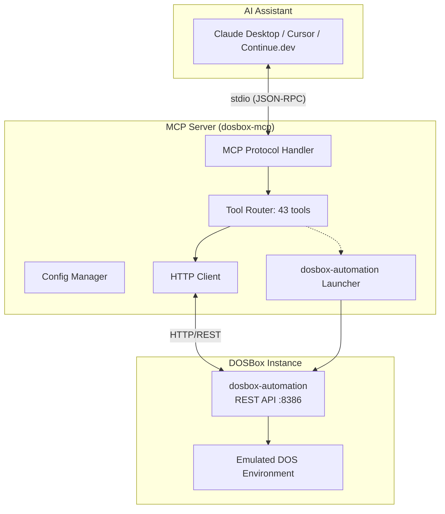
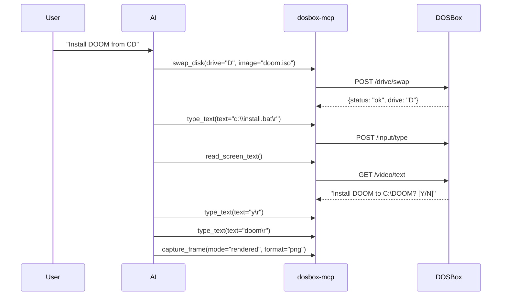

# dosbox-mcp

> **MCP Server for dosbox-automation REST API**

Control DOSBox instances programmatically via Model Context Protocol. Works with Claude Desktop, Cursor, Continue.dev, and any MCP-compatible client.

[](https://www.rust-lang.org)
[](https://modelcontextprotocol.io)
[](LICENSE)

---

## Overview

`dosbox-mcp` is a Model Context Protocol (MCP) server that exposes the **dosbox-automation** REST API as MCP tools. It enables AI assistants to programmatically control DOSBox for:

- **Game automation** — Install, configure, and play DOS games
- **Testing** — Automated regression testing of DOS applications
- **Debugging** — Memory inspection, CPU register access, I/O port monitoring
- **Screen scraping** — Text-mode and graphical frame capture
- **Input recording/replay** — Deterministic input sequences

---

## Architecture



---

## Features

### 43 MCP Tools

| Category | Tools |
|----------|-------|
| **Status** | `get_status`, `get_program_state`, `get_dosbox_info` |
| **Control** | `shutdown`, `pause`, `resume`, `get_pause_state` |
| **CPU** | `get_registers`, `get_cycles`, `set_cycles`, `set_register` |
| **Memory** | `read_memory`, `write_memory`, `search_memory`, `allocate_memory`, `free_memory`, `freeze_memory`, `list_freezes`, `clear_freezes` |
| **Input** | `type_text`, `send_input_sequence` |
| **Video** | `capture_frame`, `get_frame_info`, `read_screen_text` |
| **Recording** | `start_recording`, `pause_recording`, `stop_recording`, `get_recording_status` |
| **Drive** | `swap_disk`, `lock_mounts`, `get_mount_lock` |
| **Script** | `load_script`, `start_script`, `stop_script`, `get_script_status` |
| **Capture** | `start_video_capture`, `stop_video_capture`, `get_capture_status`, `get_compression`, `set_compression` |
| **I/O** | `read_port`, `write_port` |
| **DOS** | `get_dos_internals` |

### Auto-Start dosbox-automation

The server can automatically launch and configure dosbox-automation:

- **Binary detection** — Searches common locations (`build/release-linux/`, `/usr/local/bin/`, `PATH`)
- **Library path** — Auto-finds `libiir.so` and sets `LD_LIBRARY_PATH`
- **Webserver config** — Enables REST API with secure defaults:
  - `webserver_enabled=on`
  - `webserver_bind_address=127.0.0.1`
  - `webserver_port=8386`
  - `webserver_allow_remote=off`
  - `webserver_token_file=off`
- **Health checks** — Waits up to 30s for API readiness
- **Cleanup** — Graceful shutdown on MCP server exit

### Strongly-Typed Responses

All tools return structured types (not raw JSON) generated from the OpenAPI spec:

```rust
// Example: get_dosbox_info returns
DosBoxInfo {
    version: "dosbox-automation 0.85.1",
    features: Features { memory: true, input: true, cpu_registers: true, ... },
    binary: "/path/to/dosbox",
    appimage: None
}
```

---

## Installation

### Prerequisites

- **Rust 1.70+** — [Install Rust](https://rustup.rs/)
- **dosbox-automation** — Built from source or installed system-wide

### Build from Source

```bash
git clone https://github.com/EternalNooblet/dosbox-automation-is-not-your-nanny
cd dosbox-automation-is-not-your-nanny/tools/dosbox-mcp
cargo build --release
```

Binary: `target/release/dosbox-mcp`

---

## Quick Start

### 1. Configure MCP Client

**Claude Desktop** (`claude_desktop_config.json`):

```json
{
  "mcpServers": {
    "dosbox": {
      "command": "/path/to/dosbox-mcp",
      "args": []
    }
  }
}
```

**Cursor** (`.cursor/mcp.json`):

```json
{
  "mcpServers": {
    "dosbox": {
      "command": "/path/to/dosbox-mcp",
      "args": ["--config", "~/.config/dosbox-mcp/config.toml"]
    }
  }
}
```

### 2. Start the Server

```bash
# Auto-starts dosbox-automation (recommended)
dosbox-mcp

# Or connect to existing instance
dosbox-mcp --no-auto-start --base-url http://localhost:8386
```

### 3. Use from AI Assistant

> **User**: "Install DOOM shareware from the CD image and start it"

> **Assistant**: I'll use the dosbox MCP tools to mount the CD, run the installer, and launch DOOM.

```json
{
  "tool": "swap_disk",
  "arguments": { "drive": "D", "image": "/path/to/doom_cd.iso" }
}
{
  "tool": "type_text",
  "arguments": { "text": "d:\\install.exe\r", "cps": 20 }
}
{
  "tool": "read_screen_text",
  "arguments": {}
}
```

---

## Configuration

### Config File (`~/.config/dosbox-mcp/config.toml`)

```toml
[default]
base_url = "http://localhost:8386"
timeout_secs = 30
verify_tls = true

# Multi-instance support (Phase 3)
[[instances]]
name = "main"
base_url = "http://localhost:8386"

[[instances]]
name = "ci-runner"
base_url = "http://192.168.1.50:8386"
```

### CLI Options

```bash
dosbox-mcp [OPTIONS] [-- <DOSBOX_ARGS>...]

Options:
  --base-url <URL>           dosbox-automation API URL [env: DOSBOX_API_URL]
  --timeout-secs <N>         Request timeout in seconds (default: 30)
  --no-verify-tls            Disable TLS verification
  --config <PATH>            Config file path
  --log-level <LEVEL>        trace/debug/info/warn/error (default: info)

  --dosbox-bin <PATH>        dosbox-automation binary path [env: DOSBOX_AUTOMATION_BIN]
  --auto-start               Auto-start dosbox-automation (default: true)
  --no-auto-start            Don't auto-start, connect to existing
  --working-dir <DIR>        Working directory for dosbox-automation

  <DOSBOX_ARGS>...           Extra args passed to dosbox-automation
```

### Environment Variables

| Variable | Description |
|----------|-------------|
| `DOSBOX_API_URL` | Base URL for dosbox-automation API |
| `DOSBOX_AUTOMATION_BIN` | Path to dosbox-automation binary |
| `DOSBOX_MCP_*` | Config overrides (e.g., `DOSBOX_MCP_TIMEOUT_SECS=60`) |

---

## Example Workflows

### Install a Game from CD



### Memory Trainer Workflow


```json
// Search for value 3 (lives) as byte
{ "tool": "search_memory", "arguments": { "value": 3, "width": 1 } }
// Returns: { "matches": [65536, 131072] }

// Freeze at first match
{ "tool": "freeze_memory", "arguments": { "address": 65536, "value": 99, "width": 1 } }

// Later: clear all
{ "tool": "clear_freezes", "arguments": {} }
```

### Automated Testing

```rust
// Record input sequence
start_recording()
// ... play game ...
let recording = stop_recording()

// Replay deterministically
send_input_sequence(events: recording.events)

// Verify frame
let frame = capture_frame(mode="raw", format="png")
assert_eq!(frame.hash, expected_hash)
```

---

## API Reference

### Status Tools

| Tool | Description | Parameters |
|------|-------------|------------|
| `get_status` | Overall emulator status | — |
| `get_program_state` | Running program info | — |
| `get_dosbox_info` | Version & feature flags | — |

### Control Tools

| Tool | Description | Parameters |
|------|-------------|------------|
| `shutdown` | Request graceful shutdown | — |
| `pause` | Pause emulation | — |
| `resume` | Resume emulation | — |
| `get_pause_state` | Current pause state | — |

### CPU Tools

| Tool | Description | Parameters |
|------|-------------|------------|
| `get_registers` | All CPU registers | — |
| `get_cycles` | Current cycles config | — |
| `set_cycles` | Set CPU cycles | `cycles: string` (e.g., "5000", "auto", "max") |
| `set_register` | Set register value | `register: string`, `value: u64` |

### Memory Tools

| Tool | Description | Parameters |
|------|-------------|------------|
| `read_memory` | Read memory (base64) | `offset: u64`, `length: u32` (max 128 MiB) |
| `write_memory` | Write memory (base64) | `offset: u64`, `data: Vec<u8>` (max 128 MiB) |
| `search_memory` | Find value in memory | `value: u64`, `width: u8` (1/2/4), `start?: u64`, `length?: u32` (max 16 MiB) |
| `allocate_memory` | Allocate DOS memory | `size: u32`, `area?: string`, `strategy?: string` |
| `free_memory` | Free allocated memory | `addr: u64` |
| `freeze_memory` | Trainer-style freeze | `address: u64`, `value: u64`, `width: u8` (1/2/4) |
| `list_freezes` | List active freezes | — |
| `clear_freezes` | Remove freezes | `address?: u64` (omit to clear all) |

### Input Tools

| Tool | Description | Parameters |
|------|-------------|------------|
| `type_text` | Type string with pacing | `text: string`, `cps?: f32` (default: 30) |
| `send_input_sequence` | Inject event sequence | `events: InputEvent[]` |

**InputEvent types:**
```json
{ "type": "key", "key": "KBD_enter", "pressed": true, "t": 0 }
{ "type": "mouse_move", "x_rel": 5.0, "y_rel": -3.0 }
{ "type": "mouse_button", "button": "left", "pressed": true }
{ "type": "mouse_wheel", "delta": 1.0 }
```

### Video Tools

| Tool | Description | Parameters |
|------|-------------|------------|
| `capture_frame` | Capture frame (base64) | `mode?: "raw"\|"rendered"`, `format?: "png"\|"jpeg"\|"raw"`, `quality?: u8` (1-100) |
| `get_frame_info` | Frame metadata | — |
| `read_screen_text` | Text-mode screen | — |

### Recording Tools

| Tool | Description | Parameters |
|------|-------------|------------|
| `start_recording` | Begin input recording | — |
| `pause_recording` | Toggle pause | — |
| `stop_recording` | Stop & return events | — |
| `get_recording_status` | Recording state | — |

### Drive Tools

| Tool | Description | Parameters |
|------|-------------|------------|
| `swap_disk` | Mount/swap disk image | `drive: string` (e.g., "A"), `image: string` (path) |
| `lock_mounts` | Lock/unlock mounts | `lock: boolean` |
| `get_mount_lock` | Mount lock state | — |

### Script Tools

| Tool | Description | Parameters |
|------|-------------|------------|
| `load_script` | Load Lua script | `script: string`, `name?: string` |
| `start_script` | Start script | — |
| `stop_script` | Stop script | — |
| `get_script_status` | Script state | — |

### Capture Tools

| Tool | Description | Parameters |
|------|-------------|------------|
| `start_video_capture` | Start ZMBV capture | `mode?: "raw"\|"rendered"` |
| `stop_video_capture` | Stop capture | — |
| `get_capture_status` | Capture state | — |
| `get_compression` | Compression levels | — |
| `set_compression` | Set ZMBV compression | `raw?: u8` (0-9), `rendered?: u8` (0-9) |

### I/O Tools

| Tool | Description | Parameters |
|------|-------------|------------|
| `read_port` | Read I/O port | `port: u16`, `width?: u8` (1=byte, 2=word) |
| `write_port` | Write I/O port | `port: u16`, `value: u32`, `width?: u8` (1/2) |

### DOS Tools

| Tool | Description | Parameters |
|------|-------------|------------|
| `get_dos_internals` | MCB map, DOS structures | — |

---

## Error Handling

All tools return structured MCP errors:

```json
{
  "error": {
    "code": -32603,
    "message": "/memory/0x1000/1024 - Connection error: error sending request...",
    "data": null
  }
}
```

Common error codes:
- `-32600` — Invalid parameters
- `-32601` — Tool not found
- `-32603` — Internal error (connection, timeout, API error)

---

## Development

### Project Structure

```
dosbox-mcp/
├── Cargo.toml
├── src/
│   ├── main.rs           # Entry point, CLI, auto-start logic
│   ├── lib.rs            # Module exports
│   ├── cfg.rs            # Configuration system
│   ├── client.rs         # HTTP client wrapper
│   ├── server.rs         # MCP server with 43 tools
│   ├── types.rs          # 35+ typed response structs
│   ├── error.rs          # Error types
│   └── dosbox_launcher.rs # Auto-starts dosbox-automation
```

### Running Tests

```bash
cargo test
```

### Adding Tools

1. Add response type to `src/types.rs`
2. Add parameter struct with `#[derive(Deserialize, JsonSchema)]`
3. Add tool method in `src/server.rs` with `#[tool(description = "...")]`
4. Rebuild: `cargo build`

---

## Troubleshooting

### "dosbox-automation binary not found"

```bash
# Specify path explicitly
dosbox-mcp --dosbox-bin /path/to/dosbox-automation

# Or set env var
export DOSBOX_AUTOMATION_BIN=/path/to/dosbox-automation
```

### "Connection refused" / "Timeout waiting for webserver"

```bash
# Check if port 8386 is free
lsof -i :8386

# Increase timeout
dosbox-mcp --timeout-secs 60

# Check dosbox-automation logs
dosbox-mcp --log-level debug
```

### "ldd: libiir.so not found"

The launcher auto-detects `libiir.so` from the build directory. If using a system install:

```bash
# Set library path manually
export LD_LIBRARY_PATH=/usr/local/lib:$LD_LIBRARY_PATH
dosbox-mcp
```

### Permission denied on disk swap

The API requires `webserver_allow_remote=true` in dosbox config for non-localhost mounts, and mounts must be within allowed paths.

---

## License

Licensed under either of:

- Apache License, Version 2.0 ([LICENSE-APACHE](LICENSE-APACHE))
- MIT License ([LICENSE-MIT](LICENSE-MIT))

at your option.

---

## Contributing

1. Fork the repository
2. Create a feature branch
3. Add tests for new functionality
4. Ensure `cargo test` and `cargo clippy` pass
5. Submit a PR

---

## Related Projects

- **[dosbox-automation](https://github.com/Niko1221/dosbox-automation)** — The DOSBox fork with REST API
- **[Model Context Protocol](https://modelcontextprotocol.io)** — MCP specification
- **[rmcp](https://github.com/modelcontextprotocol/rust-sdk)** — Rust MCP SDK

---

## Support

- **Issues**: [GitHub Issues](https://github.com/EternalNooblet/dosbox-automation-is-not-your-nanny/issues)
- **Discussions**: [GitHub Discussions](https://github.com/EternalNooblet/dosbox-automation-is-not-your-nanny/discussions)