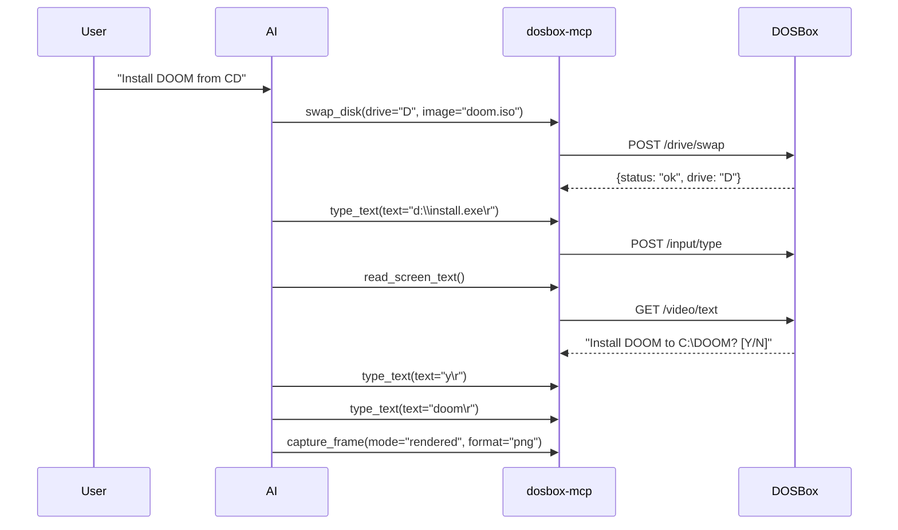

# dosbox-mcp Workflow Examples

Common workflows for game automation, testing, debugging, and scripting.

---

## Workflow 1: Install a Game from CD/ISO

### Prerequisites
- DOSBox running with dosbox-automation
- Game ISO/IMG image file

### Steps



### MCP Tool Sequence

```json
# 1. Mount the CD image
{ "tool": "swap_disk", "arguments": { "drive": "D", "image": "/path/to/doom.iso" } }

# 2. Run installer
{ "tool": "type_text", "arguments": { "text": "d:\\install.exe\r", "cps": 20 } }

# 3. Read installer screen
{ "tool": "read_screen_text", "arguments": {} }

# 4. Respond to prompts (repeat as needed)
{ "tool": "type_text", "arguments": { "text": "y\r", "cps": 20 } }
{ "tool": "read_screen_text", "arguments": {} }

# 5. Launch game
{ "tool": "type_text", "arguments": { "text": "doom\r", "cps": 20 } }

# 6. Verify visually
{ "tool": "capture_frame", "arguments": { "mode": "rendered", "format": "png" } }
```

### Prompt Template
Use the built-in prompt:
```json
{
  "method": "prompts/get",
  "params": {
    "name": "install-game",
    "arguments": {
      "drive": "D",
      "image_path": "/path/to/doom.iso",
      "install_cmd": "d:\\install.exe"
    }
  }
}
```

---

## Workflow 2: Memory Trainer (Infinite Lives/Ammo)

### Concept
Search for a known value (current lives), narrow down to single address, freeze it.

### Steps


### MCP Tool Sequence

```json
# 1. Search for current lives (3) as byte
{ "tool": "search_memory", "arguments": { "value": 3, "width": 1 } }
# Returns: { "matches": [65536, 131072, 196608] }

# 2. Lose a life in-game, then search for 2
{ "tool": "search_memory", "arguments": { "value": 2, "width": 1 } }
# Returns: { "matches": [65536] }  <-- Single match!

# 3. Freeze at found address
{ "tool": "freeze_memory", "arguments": { "address": 65536, "value": 99, "width": 1 } }

# 4. Verify freeze is active
{ "tool": "list_freezes", "arguments": {} }

# 5. Play with infinite lives...

# 6. Clean up on exit
{ "tool": "clear_freezes", "arguments": {} }
```

### Tips
- **Width matters**: Use `width: 1` for bytes (0-255), `width: 2` for words (0-65535), `width: 4` for dwords
- **Narrow iteratively**: Change value in-game, search again to filter matches
- **Verify**: Use `list_freezes` to confirm, `read_memory` to verify value
- **Clean up**: Always `clear_freezes` when done to avoid corrupting saves

### Prompt Template
```json
{
  "method": "prompts/get",
  "params": {
    "name": "memory-trainer",
    "arguments": {
      "value": 3,
      "width": 1,
      "freeze_value": 99
    }
  }
}
```

---

## Workflow 3: Automated Testing (Record/Replay/Verify)

### Concept
Record input sequence → Reset state → Replay deterministically → Verify frame

### Steps

```rust
// 1. Start recording
start_recording()

// 2. Perform test actions in DOSBox (play level, navigate menu, etc.)
// ... user plays for 30 seconds ...

// 3. Stop recording - save the events!
let recording = stop_recording()
// recording.events = [{type:"key", key:"KBD_up", pressed:true, t:0}, ...]

// 4. Reset game state (restart level, load save, etc.)
// ... reset ...

// 5. Replay deterministically
send_input_sequence(events: recording.events)

// 6. Capture result frame
let frame = capture_frame(mode="raw", format="png")

// 7. Compare with expected (hash, pixel diff, etc.)
assert_eq!(frame.hash, expected_hash)
```

### MCP Tool Sequence

```json
# 1. Start recording
{ "tool": "start_recording", "arguments": {} }

# 2. Perform test actions manually or via scripted input...

# 3. Stop and get events
{ "tool": "stop_recording", "arguments": {} }
# Save the returned events array!

# 4. Reset game state (restart, load save, etc.)
{ "tool": "type_text", "arguments": { "text": "reset_command\r" } }

# 5. Replay
{ "tool": "send_input_sequence", "arguments": { "events": [...] } }

# 6. Verify
{ "tool": "capture_frame", "arguments": { "mode": "raw", "format": "png" } }
```

### Prompt Template
```json
{
  "method": "prompts/get",
  "params": {
    "name": "automated-test",
    "arguments": {
      "test_name": "level-1-completion",
      "record_duration_secs": 30
    }
  }
}
```

---

## Workflow 4: Lua Scripting Automation

### Concept
Write Lua scripts for complex automation, run them in DOSBox.

### Basic Script
```lua
-- Simple automation script
function main()
    print("Starting automation...")
    
    -- Type a command
    dosbox.type("dir\r")
    
    -- Wait a bit
    dosbox.sleep(1000)
    
    -- Read screen
    local text = dosbox.read_text()
    print("Screen: " .. text)
    
    -- Capture frame
    local frame = dosbox.capture_frame("raw", "png")
    print("Captured frame: " .. #frame .. " bytes")
end

main()
```

### MCP Tool Sequence

```json
# 1. Load script
{ "tool": "load_script", "arguments": { "script": "function main() print('hello') end main()", "name": "test" } }

# 2. Start execution
{ "tool": "start_script", "arguments": {} }

# 3. Monitor status
{ "tool": "get_script_status", "arguments": {} }

# 4. Stop when done
{ "tool": "stop_script", "arguments": {} }
```

### Prompt Template
```json
{
  "method": "prompts/get",
  "params": {
    "name": "lua-script",
    "arguments": {
      "script": "function main() dosbox.type('dir\\r') end main()",
      "name": "dir-listing"
    }
  }
}
```

---

## Workflow 5: Screen Scraping Text-Mode Apps

### Use Case
Drive installers, menu-driven apps, read status from text-mode programs.

### Sequence
```json
# Read current screen
{ "tool": "read_screen_text", "arguments": {} }
# Returns: { "rows": 25, "cols": 80, "text": "C:\\> dir\n  Volume...\n" }

# Parse text for prompts
# Send appropriate response
{ "tool": "type_text", "arguments": { "text": "y\r", "cps": 20 } }

# Repeat until done
```

### Tips
- `read_screen_text` returns the full 80x25 text buffer
- Look for prompt patterns: `[Y/N]`, `>`, `Press any key`
- Use `cps` to control typing speed for reliable input

---

## Workflow 6: Video Capture for Recording/Streaming

### Sequence
```json
# 1. Start capture (ZMBV format)
{ "tool": "start_video_capture", "arguments": { "mode": "rendered" } }

# 2. Run game/automation...

# 3. Stop capture
{ "tool": "stop_video_capture", "arguments": {} }

# 4. Get status (file path, frames, size)
{ "tool": "get_capture_status", "arguments": {} }
```

### Compression Settings
```json
# Check current
{ "tool": "get_compression", "arguments": {} }

# Set (0=none, 9=max)
{ "tool": "set_compression", "arguments": { "raw": 5, "rendered": 7 } }
```

---

## Workflow 7: I/O Port Monitoring (Hardware Debugging)

### Read Serial Port
```json
{ "tool": "read_port", "arguments": { "port": 1016, "width": 1 } }  # COM1 data
```

### Write to Port
```json
{ "tool": "write_port", "arguments": { "port": 1016, "value": 0x80, "width": 1 } }
```

### Common Ports
| Port | Device | Purpose |
|------|--------|---------|
| 0x3F8 | COM1 | Serial data |
| 0x3F9 | COM1 | Interrupt enable |
| 0x3FA | COM1 | Interrupt ID |
| 0x3FB | COM1 | Line control |
| 0x3FC | COM1 | Modem control |
| 0x3FD | COM1 | Line status |
| 0x3FE | COM1 | Modem status |

---

## Workflow 8: DOS Internals Inspection

### MCB (Memory Control Block) Map
```json
{ "tool": "get_dos_internals", "arguments": {} }
```
Returns:
- MCB chain (allocated/free blocks)
- DOS structures (PSP, SFT, etc.)
- UMB/XMS/EMS status

Useful for:
- Memory leak detection
- Understanding game memory layout
- Debugging allocation failures

---

## Resource Access

All workflows documented as MCP Resources:
```json
{ "method": "resources/read", "params": { "uri": "docs://dosbox-mcp/workflows" } }
```

Individual tool reference:
```json
{ "method": "resources/read", "params": { "uri": "docs://dosbox-mcp/tool/search_memory" } }
```